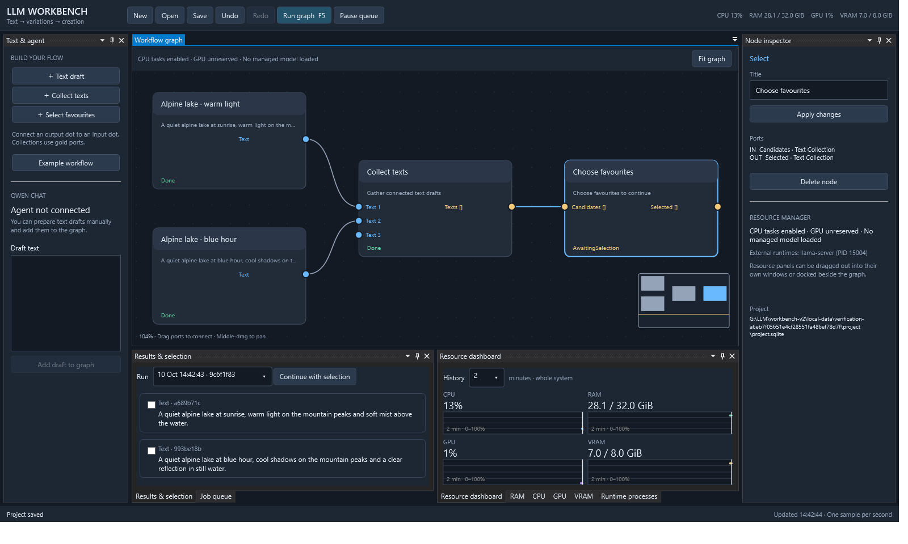

# LLM Workbench v2

Native Windows workbench for text-first visual generation workflows. C#/.NET 10, WPF, a UI-independent core, and SQLite project storage.

The first milestone — durable core and visual shell — is implemented. Qwen and media generation adapters follow in the next milestone.



## Launch

Run `./Start-Workbench.ps1`, or open `src/Workbench.Desktop/bin/Release/net10.0-windows/LLMWorkbench.exe` after building. The script builds if the executable is missing. Requires the .NET 10 Windows desktop runtime; building requires its SDK.

When running inside the existing LLM workspace, projects default to `../outputs/workbench-v2/projects`. Elsewhere they use `%LOCALAPPDATA%/LLMWorkbench/projects`. Pass `-Project <directory>` to the launcher to choose a project directory. Open existing projects using their `project.sqlite` file.

## Try the workflow

1. Click **Example workflow** for two text drafts feeding a collection and selection node, or create your own text nodes.
2. Edit text in the inspector and click **Apply changes**. Every graph edit is automatically saved.
3. Drag an output dot to an input dot to connect nodes. Blue ports carry single texts; gold ports carry collections. Right-click a node to remove incoming connections.
4. Press **F5** to execute a saved graph revision. Select the favourites node, check desired results, and click **Continue with selection**.
5. Inspect the job queue, cancel/retry work, or select a previous run. Completed artifacts and selection checkpoints survive restarting.

Scroll to zoom, middle-drag or Space+drag to pan, and use **Fit graph** or Home to frame the workflow. Graph undo/redo uses Ctrl+Z/Ctrl+Y; text editors retain their normal text undo behaviour.

RAM, CPU, GPU, VRAM, and runtime-process panels have live telemetry. Drag a panel title to float it or dock it elsewhere. Choose a shared 2/10/60-minute window; select a job to highlight its execution interval. NVIDIA temperature, power, and clocks appear when supported. Device memory includes other applications. External inference processes are observed and never stopped by this milestone.

The agent area explicitly reports that no agent is connected. Current executable operations are text publication, collection, and human selection; image/speech/music generation is not simulated.

See `docs/PLAN.md` for the agreed architecture and `docs/PROGRESS.md` for implementation steps and validation.

Build and test from this directory:

```powershell
dotnet build LLMWorkbench.slnx -c Release
dotnet test LLMWorkbench.slnx -c Release
./Test-Workbench.ps1
```

`Test-Workbench.ps1` also runs the actual desktop application off-screen, checks graph editing/undo and rejected connections, executes the text-selection workflow, validates telemetry and floating a resource panel, and writes a screenshot plus reports under ignored `local-data/`.

## Architecture

- `Workbench.Core`: typed graph, artifact/run/job contracts, shared edit commands, resource leases, and history.
- `Workbench.Infrastructure`: SQLite projects, asynchronous queue, built-in text/selection executor, and Windows/NVML telemetry.
- `Workbench.Desktop`: WPF/AvalonDock shell, lightweight graph renderer, result controls, and resource charts.
- `Workbench.Tests`: graph, persistence, execution, resource ownership, and telemetry checks.

Project databases use an exclusive application ownership lock and schema validation. Current graph edits and historical execution snapshots are separate. Each project keeps generated text files beside its database.

The canvas behaviour is adapted from the user's DataStudio2 application, and GPU monitoring from the original SD Workbench. Resource providers use [Windows performance information](https://learn.microsoft.com/en-us/windows/win32/api/psapi/nf-psapi-getperformanceinfo) and NVIDIA NVML. SQLite access follows [Microsoft's concurrency guidance](https://learn.microsoft.com/en-us/dotnet/standard/data/sqlite/database-errors).
