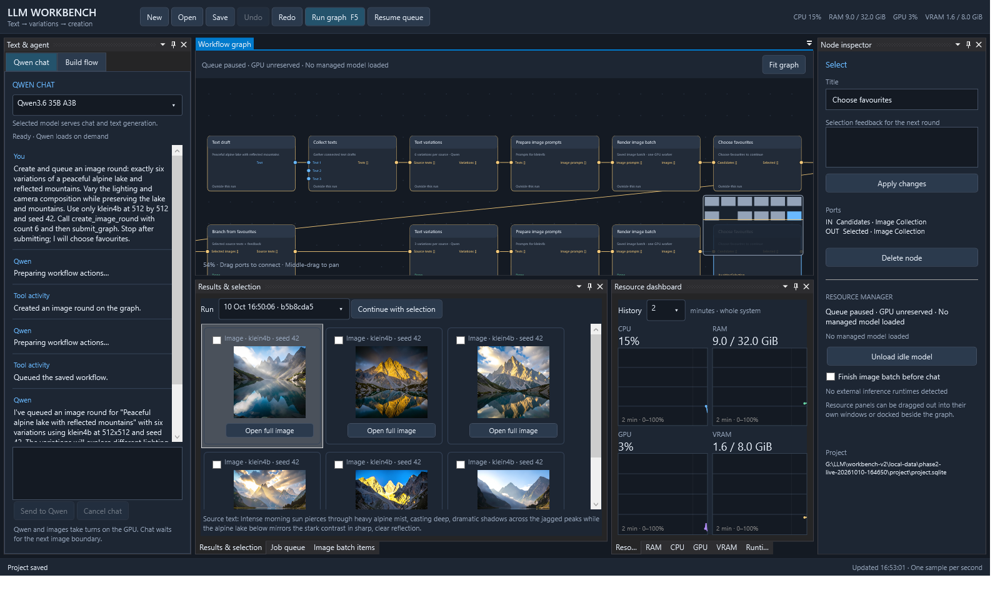
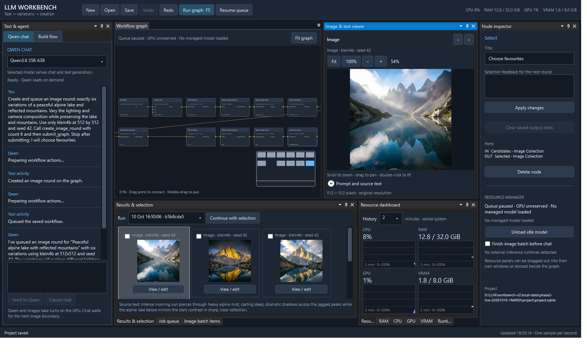

# LLM Workbench v2

Native Windows workbench for text-first visual generation workflows. C#/.NET 10, WPF, a UI-independent core, and SQLite project storage.

Phases 1 and 2 are implemented: durable projects, native graph editing, streaming Qwen chat/tools, prompt variations, image batches, human selection, and successive rounds.



## Launch

Run `./Start-Workbench.ps1`, or open `src/Workbench.Desktop/bin/Release/net10.0-windows/LLMWorkbench.exe` after building. The script builds if the executable is missing. Requires the .NET 10 Windows desktop runtime; building requires its SDK.

When running inside the existing LLM workspace, projects default to `../outputs/workbench-v2/projects`. Elsewhere they use `%LOCALAPPDATA%/LLMWorkbench/projects`. Pass `-Project <directory>` to the launcher to choose a project directory. Open existing projects using their `project.sqlite` file.

## Try the workflow

1. Click **Example workflow** for two text drafts feeding a collection and selection node, or create your own text nodes.
2. Edit text in the inspector and click **Apply changes**. Every graph edit is automatically saved.
3. Drag an output dot to an input dot to connect nodes. Blue ports carry single texts; gold ports carry collections. Right-click a node to remove incoming connections.
4. Press **F5** to execute a saved graph revision. Select the favourites node, check desired results, and click **Continue with selection**.
5. Inspect the job queue, cancel/retry work, or select a previous run. Completed artifacts and selection checkpoints survive restarting.

Scroll to zoom, middle-drag or Space+drag to pan, and use **Fit graph** or Home to frame the workflow. Graph undo/redo uses Ctrl+Z/Ctrl+Y; text editors retain their normal text undo behaviour.

RAM, CPU, GPU, VRAM, and runtime-process panels have live telemetry. Drag a panel title to float it or dock it elsewhere. Choose a shared 2/10/60-minute window; select a job to highlight its execution interval. NVIDIA temperature, power, and clocks appear when supported. Device memory includes other applications. External inference processes are observed and never stopped by this milestone.

## Qwen and image rounds

In **Qwen chat**, ask: “Create and render six variations of an alpine lake, using klein4b at 512×512, seed 42.” Qwen uses validated graph tools and queues a saved run. Chat replies stream, and the conversation and tool results persist in the project.

Use the model dropdown above the chat to choose **Qwen3.6 35B A3B** or **Qwen3.6 Genesis / Hermes 35B A3B**. The choice also applies to text variations and image-prompt preparation, and is saved per project. Change it between active GPU operations; the next request unloads the previous worker and loads the chosen model. Missing profiles are disabled.

Alternatively, use **Build flow → Image round** to enter a brief, variation instructions, model, dimensions, and seeds. The preview shows the Cartesian expansion before you add the round. Press **Run graph** to execute it. Individual text, variation, preparation, image, and selection nodes are also available.

Select the **Choose favourites** node when it reaches its checkpoint. Check images, enter optional feedback in the inspector, and click **Continue with selection**. Choose the number of variations per selected source under Build flow, then click **Next round from selection**. That action queues only the new branch and keeps earlier images and runs. You can also ask Qwen to branch from the completed selection.

Images appear as contact sheets, with model and seed. Click a result or **View / edit** to open it in the dockable **Image & text viewer** and highlight its source path. The viewer loads the original image: scroll to zoom around the cursor, drag with the left or middle mouse button to pan, and double-click or press Home to fit. The toolbar has Fit, 100%, and zoom buttons; arrow keys pan, +/− zoom, and 1 shows actual size. Expand **Prompt and source text** to inspect the text behind an image or open its source description/prepared prompt for editing. Drag the viewer title to float or dock it. The **Image batch items** panel shows each render's seed, state, and attempt. Failed/cancelled batches retain completed images; retry renders only unfinished items with the same resolved settings and seeds.

Select a text draft to edit it in the viewer, or select a generated text/variation/prepared prompt from Results. **Save text edits** saves pending edits, and **Run downstream with edits** saves them and runs from that node, retaining other inputs needed by joins. Edits to generated texts save new artifacts and use the complete output collection from that node, including unedited siblings; original results remain attached to their historical runs. Prepared-prompt edits preserve the model, seeds, negative prompt, dimensions, and rendering settings. Downstream execution reuses saved outputs without asking Qwen to generate them again. **Run graph / F5** also saves pending viewer edits and uses saved manual outputs. Text drafts survive navigating between nodes/results; Ctrl+S saves them, and unfinished blank drafts are retained on close for the next session.

The source node's inspector reports saved output edits. **Clear saved output edits** returns that node to normal generation on the next run; graph Undo/Redo can restore or remove the overrides. Editing a draft directly also restores that draft's normal text output. Earlier runs and images stay available.



The preparation inspector accepts multiple image profile IDs and multiple seeds for model/render comparisons. Each prompt is prepared separately using its target model's guidance. The actual prepared prompt, settings, source IDs, profile snapshot, and file size/modification fingerprints are saved. Source descriptions remain separate from negative prompts and rendering settings. Semantic preservation still needs human review.

`models.json` is the reloadable v2 model library, initially adapted from v1's installed profiles. Use **Refresh model library** after editing it. Missing weights are listed with their paths. The default image profile is FLUX.2 klein; Z-Image and Qwen-Image profiles retain their established defaults. This phase supports text-to-image; image-edit nodes and audio adapters follow later.

Qwen and image workers take turns through one GPU lease. Servers started by v2 use private loopback ports and are stopped on model switches, cancellation, selection checkpoints, or application exit. Other inference processes remain external; v2 reports the conflict and leaves them running. Keep other inference servers closed while using v2. Queue pause takes effect at the next image boundary. Chat normally yields into the next boundary; **Finish image batch before chat** enables throughput preference. **Unload idle model** releases an idle managed server.

Both Qwen profiles match their existing manual launchers in `../scripts/`: 128K context, q8 KV cache, flash attention and MTP. Stock Qwen keeps 39 expert layers on CPU; Genesis keeps all 40 on CPU and includes its custom chat template and CPU vision projector. Workbench still sends text only. The prior reduced 16K/no-MTP profile accounted for its lower VRAM use and slower prompt ingestion. `EstimatedVramBytes` is an admission estimate, not a GPU memory cap. Full conversation history remains saved; old complete turns are trimmed from the request as necessary. Set `UseActionEnvelope: true` on the text profile to use the validated structured-action fallback with another template/build.

Each project's `runtime.log` records launch arguments, timestamps, stdout/stderr, lifecycle transitions and unexpected exit codes. Desktop exception details are saved in `%TEMP%/LLMWorkbench-error.log`.

See `docs/PLAN.md` for the agreed architecture and `docs/PROGRESS.md` for implementation steps and validation.

Build and test from this directory:

```powershell
dotnet build LLMWorkbench.slnx -c Release
dotnet test LLMWorkbench.slnx -c Release
./Test-Workbench.ps1
./Test-Phase2Live.ps1
./Test-Phase2Desktop.ps1 -Project <completed-live-check-project-directory>
dotnet run --project tools/Workbench.QwenCheck -c Release -- . ./local-data/qwen-check
```

`Test-Workbench.ps1` also runs the actual desktop application off-screen, checks graph editing/undo and rejected connections, edits text through the viewer, saves multiple result edits across navigation, checks undo/redo and immutable historical results, executes the edited downstream workflow, validates telemetry and floating a resource panel, and writes screenshots plus reports under ignored `local-data/`.

`Test-Phase2Live.ps1` uses the installed weights and actual GPU. It verifies a native streamed tool call plus matched result, asks Qwen to create/submit six images, reopens the project, selects two, and renders six next-round images. Reports, logs, prompts, and PNGs are under `local-data/phase2-live-*`. Pass `-Resume <report-directory>` to continue an interrupted check. The desktop check reopens that project off-screen and verifies conversation history, thumbnails, source paths, original-resolution viewing, cursor-centred zoom, pan, 100% view, viewer floating/docking, image-round creation/undo, and live resources.

## Architecture

- `Workbench.Core`: typed graph, artifact/run/job contracts, shared edit commands, resource leases, and history.
- `Workbench.Infrastructure`: SQLite projects/conversations/render items, asynchronous queue, shared agent dispatcher, local inference adapters, managed worker lifecycle, and Windows/NVML telemetry.
- `Workbench.Desktop`: WPF/AvalonDock shell, lightweight graph renderer, result controls, and resource charts.
- `Workbench.Tests`: graph, persistence, execution, resource ownership, and telemetry checks.

Project databases use an exclusive application ownership lock and schema validation. Current graph edits and historical execution snapshots are separate. Each project keeps generated text files beside its database.

The canvas behaviour is adapted from the user's DataStudio2 application, and GPU monitoring from the original SD Workbench. Resource providers use [Windows performance information](https://learn.microsoft.com/en-us/windows/win32/api/psapi/nf-psapi-getperformanceinfo) and NVIDIA NVML. SQLite access follows [Microsoft's concurrency guidance](https://learn.microsoft.com/en-us/dotnet/standard/data/sqlite/database-errors).
