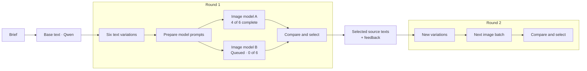

**Workbench v2 — text, agents, and visual generation workflows**

Planning document, 10 October 2026. This proposes a new application; it does not implement or install anything.

**1. Product direction**

Build a Windows desktop workbench with Qwen chat beside an editable node graph. Text is the starting material: a brief, image description, narration script, lyrics, or music description. The human and agent can both turn that material into single outputs, batches, and successive rounds of variations.

The central interaction is: **draft text → vary → generate → compare and select → branch → repeat**. All text, outputs, selections, and settings remain attached to their history. A single shot uses the same engine with one input and one generation task.

Recommended starting stack: C#/.NET 10 and WPF, matching the current workbench and DataStudio2's desktop approach. Create a separate `workbench-v2` application, with a UI-independent core, infrastructure for persistence and runtimes, and a WPF desktop shell.

**2. What the existing applications contribute**

The current workbench already provides persistent image servers, CLI fallback for operations such as ESRGAN, image model profiles and prompt guides, generation progress, GPU monitoring, image editing, workflow input resolution, and an LLM client. Reuse these through adapters where practical.

Its `WorkflowEngine`, `ModelDef`, and `RunRecord` assume image operations and image paths. Its batches are in-memory prompt lists, and its JSON stores do not provide a durable task queue. Replace these foundations with modality-independent graph, artifact, and job models. The source code is more current than parts of README.md: image generation already uses a persistent sd-server.

Inspection found Z-Image, FLUX.2 klein, Qwen-Image 2.1, and Qwen-Image 2.1 Turbo weight sets available. Qwen3.6 and Genesis/Hermes weights are present. The speech and music plans describe candidates, but those runtimes and model directories are not installed in this workspace.

DataStudio2 provides useful visual components:

| Reference | Proposed use |
| --- | --- |
| `Controls/InfiniteCanvas.cs` | Zoom, pan, canvas coordinates, and grid |
| `Controls/CanvasMinimap.cs` | Overview and viewport navigation |
| `ConnectionViewModel.cs` and connection templates | Curved wires and connection highlighting |
| Node templates and node selection interactions | Node cards, ports, previews, and inspector selection |
| `UndoRedoService.cs` | Starting pattern for graph editing commands |
| Docked toolbox, canvas, and inspector | Reference for the desktop layout |

Adapt these visual components after checking their dependencies; the generation app does not need DataStudio2's numerical, table, plotting, or scripting dependencies. Do not directly adopt its execution service: it invokes `Compute()` on the UI thread and uses in-memory input hashes for caching. Generation needs asynchronous execution, explicit run requests, durable state, and artifact identity. Port type validation and cycle detection must be enforced in the core for both UI and agent edits, regardless of what the canvas displays.

**3. The main screen**

- **Left: Qwen chat.** Streaming replies, saved conversations, tool activity, and attachments referring to selected text, nodes, or outputs. The agent can work on the current selection or a named branch.
- **Centre: node graph.** Zoomable canvas, minimap, manual wiring, automatic placement for agent-created branches, collapsible rounds, and inline previews. Respect manually positioned nodes; provide an explicit Arrange action.
- **Right: inspector and model library.** Edit the selected node's text, variation instructions, generator model, parameters, references, and execution policy. Show supported capabilities and missing dependencies.
- **Bottom: result browser and queue.** Image contact sheets, audio players with waveforms, text comparisons, favourites, ratings, job progress, logs, and retry controls.
- **Resource panels:** Dedicated, dockable and floatable RAM, CPU, GPU, and VRAM panels, plus a combined dashboard with runtime processes, model residency, and scheduler state. Keep compact meters visible while the detailed panels are collapsed.
- **Global model status.** Show the selected model separately from the model actually loaded, plus RAM/VRAM usage and current loading or unloading activity.

Selecting an output highlights its source text and the path that produced it. Selecting a node filters the result browser to that node's outputs. A chat instruction can create or modify graph nodes through the same commands used by manual edits.

**4. A graph that shows both intention and progress**

The editable graph describes operations. Each execution creates a saved run against a graph revision. The canvas overlays the chosen run's status; old results remain accessible when the graph changes.

Initial node families:

| Node | Input and output |
| --- | --- |
| Text / Import | Human-authored, imported, or chat-authored text → text artifact |
| Generate / Rewrite Text | Brief or existing text + instructions → text artifact(s), using Qwen |
| Variations | Text + varied dimensions + preserved fields → text collection |
| Prepare for Model | Text → target-specific prompt, speech specification, or music specification |
| Generate Image / Speech / Music | Compatible text/specification + profile + optional references → media collection |
| Compare / Select | Artifact collection → selected collection and recorded feedback |
| Branch from Selection | Selected outputs + feedback → originating text/specifications for the next round |
| Export | Selected artifacts → requested files |

Image refine, region edit, reference edit, and upscale can then expose the existing workbench capabilities as additional node types. Future video, transcription, and mastering nodes can use the same contracts.

Ports declare both type and cardinality: Text, Image, SpeechAudio, MusicAudio, a typed specification, a collection of one of these, or a selection. Any text-to-specification preparation is visible and saved. An image prompt must not silently become a narration script just because both contain strings. Incompatible connections are rejected with an explanation.

Node states include Draft, Ready, Queued, Loading Model, Running, Awaiting Selection, Done, Failed, Cancelled, Interrupted, and Blocked by Input. Use icons and labels as well as colour. Render progress might show `4/12 outputs · sample 6/8`; model loading shows its own phase. Use an indeterminate indicator when the backend has no measurable progress.

Each batch is one node at the overview level, with output counts and a few previews. Expand it into individual jobs/results when needed. Large graphs need collapsed rounds, lightweight thumbnails, and reduced preview detail while zoomed out. The canvas should not instantiate a full media viewer for every output.

The engine emits progress events keyed by run, node, job, and attempt. The UI subscribes to those events and updates the canvas, queue, and result browser together. The graph reflects the engine's saved state; visual animations do not determine execution.

**5. Variation and iteration semantics**

Expose distinct ways of exploring:

- **Text variations:** change wording or creative content according to instructions.
- **Rendering variations:** hold the text fixed and vary seed, image settings, voice, delivery, or supported musical controls.
- **Model comparison:** render the same source with several model profiles, preserving any model-specific prepared prompts.
- **Media edits:** use a previous output as a reference or editable source when the backend supports it.

For speech, preserve the exact spoken words by default when comparing voice or delivery. Rewriting the script is a separate action. For music, store caption, lyrics, and section structure separately from controls such as duration, tempo, and language. For images, store descriptions separately from negative prompts, references, and render settings.

A variation request specifies its count, source revision, editable dimensions, preserved fields, and optional feedback. Mechanically preserve locked structured fields. Semantic instructions such as preserving a character's personality are evaluated and flagged where possible, rather than presented as guarantees.

Preview the batch matrix before execution: for example, six texts × two models × three seeds means 36 jobs. State whether collections are paired by position or expanded as a Cartesian product. Resolve random seeds and model defaults into explicit values when jobs are created.

Selecting a result retains its originating text, prepared prompt, model, seed, and feedback. Branching can vary that text, keep it and change rendering settings, or perform a supported media edit. A next round adds a new branch and group; it does not overwrite the previous round.

The execution graph remains acyclic. Repetition creates successive rounds. A later automatic iteration recipe can expand bounded rounds with explicit maximum jobs and stopping criteria.

An example visual workflow compares two image models, then starts a second round from the selected results. Speech and music use the same shape with their own preparation and generation nodes:

**6. Core data and persistence**

Use these domain entities:

| Entity | Responsibility |
| --- | --- |
| Project | Graph revisions, conversations, artifact library, and runs |
| Node / Edge / Port | Recipe structure and typed dependencies, identified by stable IDs |
| Artifact | Immutable text revision or media output, metadata, and parent links |
| Artifact Set | Ordered, saved collection used by a batch or selection |
| Run / Job / Attempt | Execution snapshot, task state, retries, timings, and errors |
| Selection | Chosen artifact IDs, ratings, and feedback |
| Model Profile | Backend, model files, capabilities, defaults, and prompt guidance |

Each project should have a SQLite database for transactional metadata and job state, with text/specification files and media assets beside it. Keep model weights under the existing `G:/LLM/models` root and v2 projects under `G:/LLM/outputs/workbench-v2/projects`.

Save actual prompts, resolved seeds/settings, input artifact IDs, model identity, runtime/build identity, and available model file fingerprints. This supports replay and comparison; it does not promise bit-for-bit reproducibility across runtime or hardware changes.

Saving a successful output must validate the file and commit its artifact and job status consistently. Publish completed files from temporary locations and recover unfinished writes after restart. Interrupted jobs remain identifiable and can be retried without rerunning completed batch items. Saving errors must be visible.

Edits create new text or graph revisions. A running job keeps its input snapshot even if the human edits the graph. Mark affected downstream nodes as needing a new run without deleting their earlier results. Reuse existing results explicitly by saved job identity; a Generate Again action creates a new attempt or run with a clear seed policy.

**7. Shared human and agent tools**

Both interfaces call a single command service. Initial actions include listing model capabilities, reading artifacts, saving texts, creating/configuring/connecting nodes, preparing variations, creating and submitting batches, selecting outputs, branching, inspecting jobs, cancelling, and exporting.

Qwen receives JSON tool schemas and a compact view of the project and current selection. Implement streamed tool-call assembly, argument validation, matched tool results, persisted conversations, cancellation, and bounded recovery from malformed calls. The current LLM client only collects reply content; it needs this additional agent protocol.

Upstream llama.cpp supports function calling with `--jinja`, but the installed Prism build and the actual Qwen/Genesis templates must be checked with complete tool-call conversations before relying on it. The local Genesis template contains tool formatting. If native tool parsing is unreliable, a schema-constrained action envelope can use the same validated dispatcher. [Upstream function-calling documentation](https://github.com/ggml-org/llama.cpp/blob/master/docs/function-calling.md)

Apply multi-node edits as validated transactions with undo. Never execute arbitrary model-generated shell commands. Generative steps run when the human or agent requests execution; dragging nodes or changing settings only updates the recipe. Show the planned operation/count and progress in the UI without introducing a confirmation dialog for every requested generation.

Long operations return job/run IDs immediately. The agent must not hold a GPU reservation while waiting for a generation job that needs that same GPU. Persist submission and tool results, let the Qwen turn finish, then give the scheduler the card. Recipe text-generation steps acquire Qwen through the scheduler rather than recursively calling it inside an active model completion. Use command IDs to prevent repeated tool delivery from duplicating batches.

Human selection is the default checkpoint. Qwen can inspect images only with a working vision configuration. Transcript checks and audio measurements can assist speech review, but do not establish voice quality or musical taste. Automatic audio ranking would need a separately validated audio evaluator.

**8. Dynamic model loading and resource scheduling**

Replace image-only configuration with a reloadable registry of model profiles. Each profile declares its runtime adapter, files and companion components, operation capabilities, supported fields/ranges, launch options, CPU/GPU policy, memory estimates, prompt guidance, and measured performance.

Adding another model supported by an existing runtime should require registering a profile and refreshing the library. A new architecture or runtime needs an adapter. A weight file alone is insufficient to guarantee compatibility. Make availability, missing files, and unverified capabilities visible.

Adapters provide validation, model preparation/load/unload, generation, progress, health, cancellation, and artifact discovery. Start with the installed llama.cpp-prism and stable-diffusion.cpp runtimes. Prefer persistent HTTP workers when useful, with CLI workers behind the same contracts where appropriate.

The GTX 1070 Ti has 8 GB VRAM and the machine has 32 GB RAM. The existing Qwen profile uses most of both. Default to one GPU generation worker at a time and budget host RAM as well as VRAM.

For a typical round:

1. Load Qwen and prepare all requested text variants and model-specific prompts.
2. Persist them and finish the current agent turn.
3. Unload Qwen, verify process exit/resource release, and load the required media profile.
4. Render compatible ready jobs consecutively, keeping that model loaded.
5. Pause at the selection checkpoint; reload Qwen when another text/agent turn is needed.

Group compatible ready jobs by model without changing their dependencies or logical ordering. Offer a throughput policy for completing a batch, and an interactive policy for yielding to chat at the next job boundary. A model change affects future jobs and waits for the active job unless the user cancels it.

The chat UI remains usable during rendering: the human can type, edit text, inspect results, and queue messages. Qwen responses wait until the scheduler gives it resources. Continuous inference beside a renderer would need a measured CPU/smaller-model configuration or another endpoint; CPU placement alone does not solve the RAM constraint.

Automatically switch workbench-owned processes. Track externally started servers separately and require an explicit handover policy before stopping or taking control of them, since other applications may be using port 8080. Do not infer exact model identity from the shared Qwen alias alone.

Cancellation is backend-specific. The current image runner stops its server to interrupt a running job; reflect the resulting unload on the canvas and queue. Health/resource checks with a timeout should replace reliance on a fixed delay alone.

**8.1. Resource dashboard and monitoring panels**

The resource manager has its own visual workspace, building on the old workbench's NVML-backed GPU/VRAM monitor and scrolling charts. Provide separate panels that can be docked beside the graph, grouped into tabs, resized, or floated into a monitoring window. Monitoring runs even when the generation queue is idle.

| Panel | Main information |
| --- | --- |
| RAM | Physical RAM used/available/total, memory usage history, and system commit used/limit; show paging activity where available |
| CPU | Overall utilisation, per-logical-core charts, and CPU consumption of managed runtime processes |
| GPU | Device name, utilisation history, and available compute/engine activity; show temperature, power, and clocks as optional supported metrics |
| VRAM | Dedicated memory used/free/total and history, scheduler headroom, and measured versus estimated requirements for the next job; display shared GPU memory separately when available |
| Runtime processes | Workbench and worker PIDs, model/profile, ownership, CPU, RAM working set/private memory, and per-process GPU/VRAM measurements where the driver exposes them |
| Models and scheduler | Actual loaded models/components, loading/unloading state, GPU reservation owner, current node/job, queued demand, scheduling policy, and why a job is waiting |
| Storage / I/O | Optional model-disk read throughput, output write throughput, and available space, useful for understanding loading and paging delays |

Use a shared time axis and configurable windows, initially 2 minutes, 10 minutes, and 1 hour. Annotate model load/unload, job start/end, cancellation, and retries on the charts. Selecting a graph node or job highlights its execution interval, making it possible to see resource usage during text preparation, model loading, sampling, and decoding.

For each completed job, retain timings and observed resource peaks. Label device-wide peaks as system/device measurements: another application's GPU activity must not be attributed to the selected job. Model/component breakdowns remain estimates unless an adapter can measure them. Per-process memory values must retain their meaning; shared working sets cannot simply be summed as unique physical usage.

Extend the existing NVML collector and add Windows telemetry providers for CPU, RAM, and I/O. Start with approximately one sample per second, collect off the UI thread, and publish one timestamped snapshot to the dashboard, scheduler, and agent's `get_resource_status` tool. Use bounded history buffers and save per-job summaries; detailed trace export can be optional. Validate which additional metrics the actual Windows driver and device provide. Unsupported readings show unavailable, and stale samples show their age, rather than appearing as zero.

The dashboard should explain the next action, for example: `Image batch waiting: Qwen unloading`, or `Ready to load model; waiting for memory headroom`. Keep measured usage, scheduler budgets/reservations, and model estimates visually distinct. Track real process exit and memory release rather than marking an unload complete solely because a delay expired. Resource telemetry informs admission decisions but does not guarantee that a model will fit; retain load-failure recovery.

Provide controls for pausing/resuming the queue, changing throughput/interactive scheduling, yielding to chat at the next job boundary, and unloading an idle managed model. Show externally owned processes separately and preserve the explicit handover policy. Basic RAM/CPU/GPU/VRAM panels belong in the first visual-shell milestone; additional device metrics and detailed trace analysis can follow as providers are validated.

**9. Speech and music integration**

Keep the architecture open, then validate one backend per modality on this machine before committing to its UX or performance.

- **Speech candidate:** CrispASR with Qwen3-TTS, following the existing audiobook research. Its documentation describes multilingual TTS, an HTTP speech endpoint, and Windows CUDA 12.6 builds for older NVIDIA GPUs. Confirm the chosen model's controls, dependencies, actual Pascal execution, memory usage, and output quality locally. [CrispASR documentation](https://github.com/CrispStrobe/CrispASR)
- **Music candidate:** acestep.cpp with ACE-Step 1.5, following the existing music research. The project exposes caption/lyrics-driven music generation, Windows builds, and model switching. Validate the exact build, request schema, memory use, duration limits, and cancellation locally. [acestep.cpp documentation](https://github.com/ServeurpersoCom/acestep.cpp)

Record supported capabilities per backend instead of promising that all speech models offer the same voices, cloning, or delivery controls, or all music models support extension and repainting. Existing planning estimates are not measured results for this machine.

Audio results need duration, sample rate, waveform, playback, and comparison controls. Speech can later add optional transcription checks; music can later add supported extension/edit operations. Full audiobook assembly, video, and mastering are later recipes using the same engine.

**10. Build order and acceptance checks**

| Stage | Deliverable | Acceptance check |
| --- | --- | --- |
| 0. Verify contracts | Confirm actual Qwen tool protocol, image API behaviour, and reference components; perform speech/music feasibility checks before their integration | Document supported operations and measured hardware limits; no assumption that upstream support equals local support |
| 1. Durable core and visual shell | Typed graph, artifacts, project storage, run snapshots, queue, shared commands, adapted canvas/minimap, text/selection nodes, and dedicated RAM/CPU/GPU/VRAM panels | Manual graph edits persist, incompatible links/cycles fail, resource charts stay responsive, and UI state is independent of execution |
| 2. Qwen and image loop | Chat tools, text variations, image adapter, model switching, batch preview/results, and next-round branching | Chat creates six prompts, renders them, user chooses two, next round renders from those choices, and history survives restart |
| 3. Speech loop | Validated speech adapter, specification editor, waveform/player, and voice/delivery comparisons | Fixed words render with several supported profiles; favourites branch and resume through the same graph/queue |
| 4. Music loop | Validated music adapter, caption/lyrics specifications, batch comparisons, and branching | Music uses the same tools, scheduler, selections, lineage, and project format as images and speech |
| 5. Reliability and migration | Crash recovery, cancellation, model-switch failure recovery, large-batch display, import/export, and existing image edit nodes | Interrupted work resumes without duplicating completed jobs; unsupported imported operations report clearly |

Make the first working milestone the **visible Qwen → variations → image batch → selection → next round** loop. It proves the central idea and the shared foundations before multiplying backends.

Meaningful automated coverage should focus on graph validation, collection expansion, fixed run snapshots, lineage, idempotent submissions, durable restart recovery, GPU reservation release, and cancellation transitions. Backend checks should use small end-to-end runs on the actual machine. Verify canvas and monitoring-panel responsiveness while generating and while browsing a large completed batch. Verify telemetry behaviour with missing providers, stale samples, external resource usage, and model-switch events.

Import v1 model profiles, run history, and workflows through a versioned importer. Preserve old output files and map existing operations to supported v2 nodes; identify records with incomplete provenance. Export project metadata and selected assets with relative paths for portability.

**11. Decisions proposed for v2**

- A native WPF application, with DataStudio2's canvas and interaction patterns adapted to generation.
- Chat and the graph are equally capable interfaces to one command and execution engine.
- Typed text/specification artifacts and collections connect all modalities.
- Each generation round remains inspectable; selecting and branching creates history.
- A graph describes the recipe; saved runs describe what actually happened.
- One GPU worker by default, with explicit model lifecycle and chat yielding at job boundaries.
- Dedicated resource panels expose RAM, CPU, GPU, VRAM, model residency, and scheduling decisions, with live history linked to graph jobs.
- Images prove the complete loop first; validated speech and music adapters follow.
- Human selection remains central, with bounded automation available for requested recipes.
